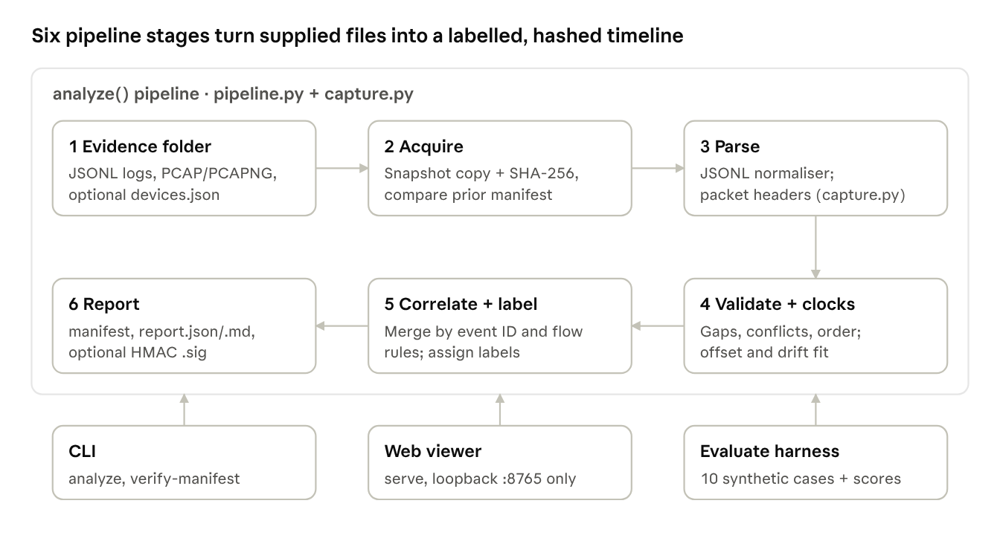
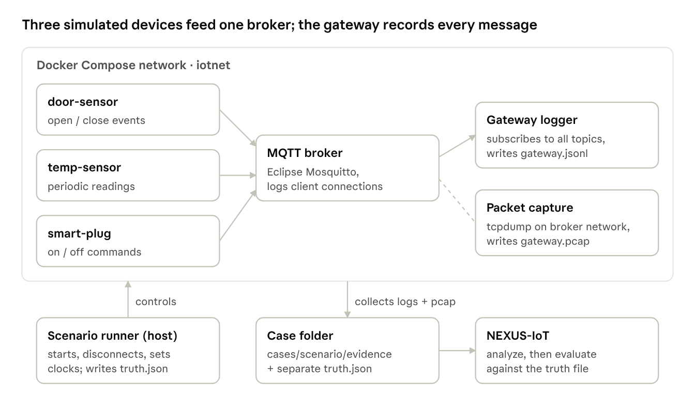

# NEXUS-IoT Project Documentation

Last updated: 18 Nov 2026 · Living version: [Claude Docs](https://claude.ai/artifact/TWNi6v9BzenhawZ1h2FtPe)

## Overview

NEXUS-IoT rebuilds one trustworthy timeline of an incident from the logs and network captures left by several IoT devices and their gateway. It is a local Python tool for digital forensics: it reads only examiner-supplied files and never collects from live devices or networks.

**The problem.** After an incident, each device holds its own log. Merging them by hand fails for three reasons:

- **Clocks disagree.** One device may run seconds fast, another slow, or jump after a reset, so events appear out of order.
- **Evidence is incomplete.** Disconnections, dropped packets or deleted lines leave holes.
- **Evidence may be altered.** An edited or inserted line can tell a false story.

**What the tool does.** It preserves the input files, checks them, corrects device clocks against the gateway, merges events, and labels how strongly each event is supported. Every timeline row points back to the file and line that support it.

**Forensic goals.**

1. Never modify source evidence; prove it with SHA-256 hashes.
2. Detect gaps, clock anomalies and signs of tampering.
3. Separate facts (Confirmed), weaker claims (Single-source) and hypotheses (Inferred, Unknown gap).
4. Produce a report an examiner can defend and another examiner can reproduce.

## Current status

The analysis engine is built and works end to end on synthetic data; the project as a whole is about 60% complete. The code is about 1,500 lines of standard-library Python 3.10+ with no third-party dependencies (repository: [swastikxojha/Nexus-IOT](https://github.com/swastikxojha/Nexus-IOT), one commit on 16 Nov 2026).

| Component | File | State |
| --- | --- | --- |
| Acquisition, hashing, prior-manifest comparison | `pipeline.py` | Done |
| Record validation (malformed rows, sequences, conflicts) | `pipeline.py` | Done |
| Clock offset and drift model, one step change | `pipeline.py` | Done |
| Timeline labels and report writing (JSON, Markdown) | `pipeline.py` | Done |
| HMAC manifest signing and verification | `pipeline.py` | Done |
| PCAP / PCAPNG header parsing and flow rules | `capture.py` | Done, headers only |
| CLI: `analyze`, `verify-manifest`, `evaluate`, `serve` | `__main__.py` | Done |
| Local web viewer | `web.py` | Basic table only |
| Synthetic scenarios and scoring (10 cases) | `scenarios.py`, `evaluate.py` | Done |
| Unit and integration tests (24) | `tests/test_project.py` | Done, not re-run for this review |
| Realistic evidence (simulated testbed) | — | Not started |
| MQTT payload parsing | — | Not started |
| PDF / HTML report export, visual timeline | — | Not started |
| Project write-up | — | This document is the start |

The tests were not executed during this review; run `python -m unittest discover -v` to confirm they pass.

## System architecture

All three entry points call one function, `analyze()`, which runs six stages in order and writes its outputs outside the evidence folder.

Scenario generation (`scenarios.py`) and scoring (`evaluate.py`) stay outside the evidence pipeline, so ground truth never reaches the analyzer.

## Forensic principles

The tool treats evidence as read-only and never states more than the evidence supports.

**Preservation.** Each input is copied to a temporary snapshot while it is hashed with SHA-256; parsing uses the snapshot bytes, and the source is never edited. File size, modification time and inode are checked before and after the copy to flag a file that changed mid-read. Output must be written outside the evidence folder.

**Integrity over time.** Reusing an output folder compares current hashes with the previous manifest and reports changed or missing files. An optional HMAC-SHA256 signature (key of 32+ bytes, stored apart from the evidence) detects later edits to the manifest. HMAC is a shared secret, so it does not prove who created a manifest.

**Event labels.**

| Label | Rule | Meaning |
| --- | --- | --- |
| Confirmed | 2+ distinct sources report the same event ID and name | Strongest claim; sources are not proven independent |
| Single-source | One source, or sources disagree | Claim rests on one witness; conflicts are flagged, not resolved |
| Inferred | 4+ periodic events and a gap ≥ 1.75× the median period | Low-confidence hypothesis, ±25% window |
| Unknown gap | Sequence numbers or numbered IDs skip | Something is missing; content and exact time unknown |

**Clock handling.** A device clock is corrected only with 3+ matching gateway anchors and a stable fit (default limits ±1,000 ppm drift, 2 s residual, 50 ms tolerance). Otherwise the offset stays diagnostic and the event is marked uncalibrated. Gateway time is an assumption, stated in every report.

**No fabrication.** The absence of a log line or packet is never treated as proof of an event or an attack.

## Evaluation

On its 10 synthetic cases the tool scores 94.8% event precision and 96.5% recall, with every seeded tamper and clock case flagged and no false alarms. `python -m nexus_iot evaluate` generates each case with ground truth stored apart from the evidence, runs the pipeline, and scores the result.

*Source: `derived/evaluation/metrics.md` in the repository, 10 synthetic cases.*

Errors appear only where tampering inserts or edits records: inserted claims count as false positives, edited ones as misses. Unknown-gap and inferred-event precision and recall are 100%, mean completeness is 96.7%, and each case processes in about 0.018 s. These figures describe the generated fixtures only; the Docker testbed will provide a harder, more realistic benchmark.

## Remaining work

Six must-have items remain before the project is complete; three more would make it a professional tool.

**Must have**

- [ ] **Docker simulation testbed** — realistic multi-device evidence with recorded ground truth (design below).
- [ ] **MQTT parsing** — read client ID, topic and message type from captures, not only packet headers.
- [ ] **Better web UI** — visual timeline, filters by device and label, click an event to see its source line.
- [ ] **Report export** — PDF or HTML report with case details, hashes, timeline and findings.
- [ ] **Repository cleanup**
    - Remove 9 committed `__pycache__` files, legacy `data/evidence/` and the duplicate `sample_inputs/`.
    - Align versions: `pyproject.toml` says 0.1.0, `pipeline.py` says 1.0.0.
    - Split `pipeline.py` (553 lines) into modules and expand dense one-line code.
    - Fix the CLI help ("E1-E7") to match the 10 cases; add a LICENSE.
- [ ] **Project write-up** — complete this document with testbed results and a tool comparison.

**Nice to have**

- [ ] **Case management** — case number, examiner, chain-of-custody log, notes on events.
- [ ] **Detection rules** — a device going silent, a clock jump, an unknown device appearing.
- [ ] **Packaging and CI** — Docker image for the tool, GitHub Actions running the tests.

## Planned Docker simulation testbed

A Docker Compose testbed replaces physical hardware: three Python device containers talk MQTT to a Mosquitto broker while a gateway logger and tcpdump record what they send. Each run produces a case folder in the format the pipeline already reads, plus a ground-truth file it never sees.

**How devices produce realistic evidence.**

- Each device writes its own JSONL log with `event_id`, `sequence`, `device`, `event` and its own `timestamp`.
- Clock error is simulated in software (an offset, a drift in ppm, or a step at a set second), because containers share the host clock.
- The gateway logger stamps each message on arrival with the gateway clock, giving the pipeline its clock anchors.
- A `devices.json` maps fixed container IPs to devices so capture flow rules can link packets to events.
- The runner records every true event and time in `truth.json`, in the format `evaluate.py` already scores.

**Planned scenarios.**

| ID | Scenario | How it is produced | Expected tool behaviour |
| --- | --- | --- | --- |
| S1 | Normal operation | All devices run, clocks in sync | Events Confirmed |
| S2 | Device disconnection | `docker network disconnect` one device for a set time | Device-only events and an Unknown gap at the gateway |
| S3 | Clock step | One device jumps its clock forward mid-run | Piecewise clock fit, step flagged |
| S4 | Clock drift | One device drifts beyond the 1,000 ppm limit | Correction refused, anomaly flagged |
| S5 | Capture gap | Packet capture paused for a set time | Missing packets; JSONL evidence still Confirmed |
| S6 | Post-collection tampering | A collected log copy has a line deleted, edited or inserted | Sequence gap, conflicting claim, or hash change against the prior manifest |
| S7 | Combined | S2 + S3 + S6 in one run | Each finding reported separately |

## Roadmap and milestones

The work runs in four phases, each closed by a gate; documentation comes first so the build follows an agreed design.

Open question: what is the submission deadline, and does it require a written report in a set format? The answer sets each phase's length.

## Limitations and references

The current results describe behaviour on known fixtures, not real-world accuracy or courtroom suitability.

- **Synthetic evaluation.** The same author wrote the generator and the analyzer, so near-perfect scores are expected; the Docker testbed reduces but does not remove this bias.
- **Hashes prove bytes, not history.** A first-run hash cannot reveal edits made before acquisition, and it does not establish chain of custody or authorship.
- **Careful tampering can evade detection.** An edit that keeps event IDs, sequence numbers, timing and cross-source agreement consistent may go unflagged.
- **Narrow capture support.** Ethernet, raw IP and Linux cooked v1/v2 headers only; no payload decoding or TCP stream reassembly.
- **Simple clock model.** At most one step change and two linear segments; the gateway clock is assumed correct.
- **Single-user local UI.** Loopback only, no authentication.

**Tools to compare against in the write-up:** [Wireshark](https://www.wireshark.org/) (packet analysis), [Plaso / log2timeline](https://github.com/log2timeline/plaso) (super-timelines), [Autopsy](https://www.autopsy.com/) (case-based forensics), [Eclipse Mosquitto](https://mosquitto.org/) (MQTT broker used in the testbed).
