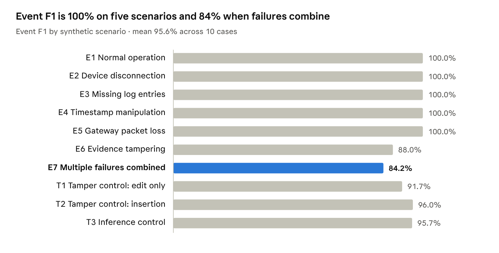
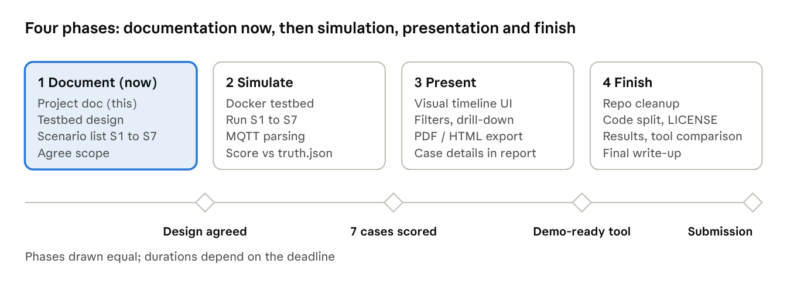

# NEXUS-IoT Project Documentation

Last updated: 18 Nov 2026 (v1.2.0) · Living version: [Claude Docs](https://claude.ai/artifact/TWNi6v9BzenhawZ1h2FtPe)

## Overview

NEXUS-IoT rebuilds one trustworthy timeline of an incident from the logs and network captures left by several IoT devices and their gateway. It is a local Python tool for digital forensics: it reads only examiner-supplied files and never collects from live devices or networks.

**The problem.** After an incident, each device holds its own log. Merging them by hand fails for three reasons:

- **Clocks disagree.** One device may run seconds fast, another slow, or jump after a reset, so events appear out of order.
- **Evidence is incomplete.** Disconnections, dropped packets or deleted lines leave holes.
- **Evidence may be altered.** An edited or inserted line can tell a false story.

**What the tool does.** It preserves the input files, checks them, corrects device clocks against the gateway, merges events, and labels how strongly each event is supported. Every timeline row points back to the file and line that support it.

**Forensic goals.**

1. Never modify source evidence; prove it with SHA-256 hashes.
2. Detect gaps, clock anomalies and signs of tampering.
3. Separate facts (Confirmed), weaker claims (Single-source) and hypotheses (Inferred, Unknown gap).
4. Produce a report an examiner can defend and another examiner can reproduce.

## Current status

Version 1.2.0 is feature-complete for the planned scope: the analyzer, MQTT decoding, detection rules, the HTML report, the web UI with case management, and a Docker testbed with a multi-seed benchmark all work and are tested. The code is standard-library Python 3.10+ with no runtime dependencies; the testbed needs Docker (repository: [Anyacst/nexus-it](https://github.com/Anyacst/nexus-it)).

| Component | Files | State |
| --- | --- | --- |
| Acquisition, hashing, prior-manifest comparison | `evidence.py` | Done |
| Record validation (malformed rows, sequences, conflicts, capture jitter) | `timeline.py` | Done |
| Clock offset and drift model, one forward or backward step | `clock.py` | Done |
| Timeline labels; JSON, Markdown and HTML reports | `timeline.py`, `reporting.py`, `report_html.py` | Done |
| HMAC manifest signing and verification | `reporting.py` | Done |
| PCAP / PCAPNG parsing and flow rules | `capture.py` | Done |
| MQTT 3.1.1 decoding with TCP reassembly (capture as third witness) | `mqtt.py`, `evidence.py` | Done |
| Detection rules (match, absent-within, sequence, count-within) with example rules | `rules.py`, `rules/` | Done |
| CLI: `analyze` (`--rules`), `check-rules`, `export-html`, `verify-manifest`, `evaluate`, `serve`, `--version` | `__main__.py` | Done |
| Local web UI with filters, row drill-down, report download and saved cases (list, re-analyze, delete) | `web.py` | Done |
| Continuous integration: unit tests on Python 3.10-3.13, Docker integration on `main` | `.github/workflows/tests.yml` | Done |
| Synthetic scenarios and scoring (10 cases) | `scenarios.py`, `evaluate.py` | Done |
| Docker testbed: 5 devices, 7 seeded scenarios, benchmark | `testbed/` | Done |
| Tests: 95 analyzer tests, 138 testbed tests (10 need Docker) | `tests/`, `testbed/tests/` | All passing (Python 3.10, 3.12, 3.15) |

## System architecture

All three entry points call one function, `analyze()` in `pipeline.py`, which runs six stages in order and writes its outputs outside the evidence folder. Since v1.1.0 the stages live in separate modules: `evidence.py` (acquire, parse), `timeline.py` (validate, correlate, label), `clock.py` (clock models) and `reporting.py` (reports, signatures); `mqtt.py` decodes MQTT from captures and `report_html.py` renders the HTML report. Since v1.2.0 an optional rules stage (`rules.py`) evaluates examiner-supplied detection rules on the finished timeline; it reads the timeline only and never changes labels or validation findings.

Scenario generation (`scenarios.py`) and scoring (`evaluate.py`) stay outside the evidence pipeline, so ground truth never reaches the analyzer.

## Forensic principles

The tool treats evidence as read-only and never states more than the evidence supports.

**Preservation.** Each input is copied to a temporary snapshot while it is hashed with SHA-256; parsing uses the snapshot bytes, and the source is never edited. File size, modification time and inode are checked before and after the copy to flag a file that changed mid-read. Output must be written outside the evidence folder.

**Integrity over time.** Reusing an output folder compares current hashes with the previous manifest and reports changed or missing files. An optional HMAC-SHA256 signature (key of 32+ bytes, stored apart from the evidence) detects later edits to the manifest. HMAC is a shared secret, so it does not prove who created a manifest.

**Event labels.**

| Label | Rule | Meaning |
| --- | --- | --- |
| Confirmed | 2+ distinct sources report the same event ID and name | Strongest claim; sources are not proven independent |
| Single-source | One source, or sources disagree | Claim rests on one witness; conflicts are flagged, not resolved |
| Inferred | 4+ periodic events and a gap ≥ 1.75× the median period | Low-confidence hypothesis, ±25% window |
| Unknown gap | Sequence numbers or numbered IDs skip | Something is missing; content and exact time unknown |

**Clock handling.** A device clock is corrected only with 3+ matching gateway anchors and a stable fit (default limits ±1,000 ppm drift, 2 s residual, 50 ms tolerance). Otherwise the offset stays diagnostic and the event is marked uncalibrated. Gateway time is an assumption, stated in every report.

**No fabrication.** The absence of a log line or packet is never treated as proof of an event or an attack.

## Evaluation

On its 10 synthetic cases the tool scores 94.8% event precision and 96.5% recall, with every seeded tamper and clock case flagged and no false alarms. `python -m nexus_iot evaluate` generates each case with ground truth stored apart from the evidence, runs the pipeline, and scores the result.

*Source: `derived/evaluation/metrics.md` in the repository, 10 synthetic cases.*

Errors appear only where tampering inserts or edits records: inserted claims count as false positives, edited ones as misses. Unknown-gap and inferred-event precision and recall are 100%, mean completeness is 96.7%, and each case processes in about 0.018 s. These figures describe the generated fixtures only; the Docker testbed will provide a harder, more realistic benchmark.

## Remaining work

The planned must-have work is complete. Optional extensions, in order of value:

- [x] **Case management**: saved cases with name, case number, examiner, rules file and analysis history; re-analysis compares hashes with the previous run; delete removes derived outputs only.
- [x] **Detection rules**: JSON rules file (`match`, `absent_within`, `sequence`, `count_within`) evaluated on the corrected timeline, with findings in every report.
- [x] **Continuous integration**: GitHub Actions running the analyzer and testbed unit tests on every push.
- [ ] **Chain-of-custody log and examiner notes**: an append-only per-case log of who analyzed what and when, and notes attached to timeline rows.
- [ ] **More rule types**: time-of-day windows ("commands at unusual hours") and rules on MQTT client identity.
- [ ] **Wider protocol coverage**: CoAP or HTTP telemetry, and MQTT 5.
- [ ] **Real-device validation**: a small physical testbed with independently recorded ground truth.

## Docker simulation testbed

A Docker Compose testbed replaces physical hardware: five Python device containers publish MQTT telemetry to a Mosquitto broker while a gateway logger and tcpdump record what they send. Each run produces a case folder in the format the analyzer reads, plus a ground-truth file it never sees. Details: [`testbed/README.md`](../testbed/README.md).

| Device | Interval | Events |
| --- | --- | --- |
| door-sensor | 3 s | `door_open`, `door_close` |
| temp-sensor | 2 s | `temperature_reading` |
| smart-plug | 4 s | `plug_on`, `plug_off` |
| motion-sensor | 5 s | `motion_detected`, `motion_cleared` |
| smart-lock | 6 s | `lock_engaged`, `lock_released` |

**How devices produce realistic evidence.**

- Each device writes its own JSONL log with `event_id`, `sequence`, `device`, `event` and its own `timestamp`, and publishes only while connected.
- Clock error is simulated in software (offset, drift in ppm, or a step), because containers share the host clock.
- The gateway logger stamps each message on arrival with the gateway clock, giving the analyzer its clock anchors; the packet capture is a third, independent witness.
- The runner records every true event and time in `truth.json`, and keeps byte-identical originals with SHA-256 sums before any tampering.

**Scenarios.** Fault parameters are derived from the seed, so every seed is a different variant.

| ID | Scenario | Seeded fault |
| --- | --- | --- |
| S1 | Normal operation | none |
| S2 | Device disconnection | one device off the network for 6-22 s |
| S3 | Clock step | one device: offset up to ±10 s, then a ±5-120 s jump |
| S4 | Clock drift | one device drifts ±2,000-20,000 ppm |
| S5 | Capture gap | packet capture stopped for 5-15 s |
| S6 | Post-collection tampering | one line deleted in one log; one edited and one fabricated line in another |
| S7 | Combined | disconnect + clock step + tampering |

## Roadmap and milestones

All four phases are complete; the optional extensions under Remaining work are the next increment.

## Comparison with existing tools

NEXUS-IoT is narrow by design: it does one job that general tools leave to the examiner, namely reconciling several IoT sources with disagreeing clocks into one timeline that states how well each event is supported. The comparison below reflects each tool's general, documented purpose.

| Capability | NEXUS-IoT | Wireshark | Plaso / log2timeline | Autopsy |
| --- | --- | --- | --- | --- |
| Main input | IoT JSONL logs, gateway log, PCAP/PCAPNG | Packet captures | Disk images and many log/artifact formats | Disk images, files |
| Protocol depth | MQTT 3.1.1 only | Thousands of dissectors | Not a packet tool | Not a packet tool |
| Merges sources into one timeline | Yes | No | Yes (super-timeline) | Partly (timeline module) |
| Corrects each device's clock against a reference | Yes (offset, drift, one step) | No | No, trusts each source's timestamps | No |
| Labels how well each event is supported | Yes (Confirmed, Single-source, Inferred, Unknown gap) | No | No | No |
| Flags gaps, conflicts and clock anomalies | Yes | No | No | No |
| Evidence hashing and signed manifest | Yes (SHA-256, HMAC) | No | Hashes in storage metadata | Yes, with case management |
| Configurable detection rules | Yes (JSON, 4 rule types) | Display filters only | No (analysis plugins) | Keyword and hash-set hits |
| Evaluated against known ground truth | Yes (synthetic + Docker testbed) | n/a | n/a | n/a |

In practice the tools complement each other: Wireshark for deep inspection of a suspicious flow, Plaso or Autopsy for host artifacts, and NEXUS-IoT to reconcile the IoT devices and gateway into one defensible sequence of events.

## Limitations and references

The current results describe behaviour on known fixtures, not real-world accuracy or courtroom suitability.

- **Simulated evaluation.** Both the synthetic cases and the Docker testbed were built alongside the analyzer, so high scores are expected; the testbed adds real MQTT, TCP and Docker timing but shares the host clock and uses software-simulated clock faults.
- **Hashes prove bytes, not history.** A first-run hash cannot reveal edits made before acquisition, and it does not establish chain of custody or authorship.
- **Careful tampering can evade detection.** An edit that keeps event IDs, sequence numbers, timing and cross-source agreement consistent may go unflagged.
- **Narrow capture support.** Ethernet, raw IP and Linux cooked v1/v2; payloads are decoded only for MQTT 3.1.1, and reassembly stops at a capture gap.
- **Simple clock model.** At most one step change (forward or backward) and two linear segments; the gateway clock is assumed correct.
- **Single-user local UI.** Loopback only, no authentication.

**Tools to compare against in the write-up:** [Wireshark](https://www.wireshark.org/) (packet analysis), [Plaso / log2timeline](https://github.com/log2timeline/plaso) (super-timelines), [Autopsy](https://www.autopsy.com/) (case-based forensics), [Eclipse Mosquitto](https://mosquitto.org/) (MQTT broker used in the testbed).
